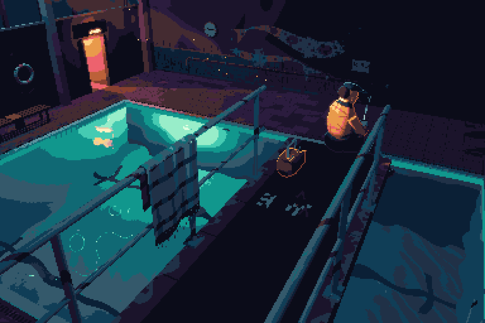

# After Hours — last light

A small set of scripts that draws a 384 × 256 pixel illustration and an
8-second, 25 fps loop with an authored 28-colour palette.




[Animated GIF](artifacts/animation/after-hours-animated.gif) · [MP4](artifacts/animation/after-hours-animated.mp4)

## Files

```text
after_hours.py   scene, renderer and still-image command
art.py           materials, mural, caustics, lighting, pose and waves
animate.py       animation, exports and the C++ bridge
fast_rays.cpp    accelerated ray intersections
verify.py        checksum, geometry, optics and animation checks
ruff.toml        140-column formatting preferences
artifacts/       finished artwork, palettes and verification reports
build/           ignored new exports, cached frames, binary and reports
```

## Run with uv

Install [uv](https://docs.astral.sh/uv/getting-started/installation/) and run these commands from this directory.

```sh
uv run after_hours.py
uv run animate.py --preview
OPENBLAS_NUM_THREADS=1 OMP_NUM_THREADS=1 uv run animate.py --workers 3
```

Each entry script declares Python 3.12.11, NumPy 2.3.5 and Pillow 13.0.0
inline. `uv` prepares the environment automatically.

Animation uses a C++17 compiler and FFmpeg with `libx264` for MP4 export.
The compiler defaults to `g++`. Set `CXX` to choose another compiler.
The build uses OpenMP when available and compiles a serial accelerator
otherwise. Use `--workers 1` to reduce memory use.

New exports go to `build/exports/` beside the scripts. Preview studies and
rendered frames go to `build/frames/`, the compiled binary to `build/native/`,
and new reports to `build/reports/`. Both rendering scripts accept path overrides.

```sh
uv run after_hours.py --output-dir build/experiment
uv run animate.py --output-dir build/experiment --build-dir build/experiment-cache --preview
uv run animate.py --export-only
```

`--export-only` reuses a complete 200-frame cache. PNGs and GIFs preserve the
pixel grid and authored palette. The MP4 uses lossy H.264 encoding. PNG and
MP4 bytes can vary with encoder builds. In a reference macOS run, one pixel
at frame 148 (5.92 seconds) differed from the included native GIF.

## Verify

The checks use the exports in `artifacts/` as references. Animation verification also uses `ffprobe`.

```sh
uv run verify.py checksums
OPENBLAS_NUM_THREADS=1 OMP_NUM_THREADS=1 uv run verify.py
uv run verify.py scene
uv run verify.py animation
```

Verification checks preserved SHA-256 hashes, 25 scene/render conditions,
accelerator parity on 8,192 rays, moving-wave geometry, loop closure,
GIF palette and timing, video metadata, and six freshly rendered animation
frames against the native GIF. Each numerical check runs with a fresh scene.
New reports go to `build/reports/`. The review sheet uses the system font when
available, so its lettering can differ between platforms.

Formatting keeps the 140-character target and allows trailing-comma blocks
to collapse when they fit.

```sh
uvx ruff@0.17.5 check .
uvx ruff@0.17.5 format --check .
uvx ruff@0.17.5 format .
```

## Artwork

A programmatic pixel illustration drawn directly on a **384 × 256** grid with
an authored **28-colour palette**. The viewing image is an exact 4×
nearest-neighbour enlargement.
No input images, external art assets, network calls or image-generation models
are used. Every texture, motif and finishing mark is authored in the code.

### Composition and motion

The elevated camera looks across a pool where turquoise light and an amber
jacket stand out against cobalt and purple shadows. The far pool lamp glows
beneath the water. A diagonal shaft of warm light reaches the figure through
the room's humid air.

The figure leans slightly toward the cup, with a lowered head, asymmetric
shoulders and legs hanging over the platform. The jacket has worn fabric
panels and connected creases.

The **eight-second seamless loop at 25 fps** has 200 separately rendered
frames on the same 384 × 256 grid. Water ripples gently, coffee steam rises
slowly and sparse dust motes catch the beam. The pose and camera stay still.
All frames share the same 28-colour palette.

The moving water is traced anew in every frame. Reflection and refraction
therefore move with the actual wave normals; the completed image is never
warped or interpolated. Wave frequencies are integer loop harmonics, with
wavelengths derived from the deep-water gravity-wave dispersion relation.
The steam and dust also use periodic motion and depth tests.

The GIFs preserve the exact palette and pixel grid. The MP4 is a compatible
H.264 version for convenient phone playback; its lossy YUV encoding is not
an exact-colour master. Both enlarged exports use integer scaling.

### Art direction

- Deep cobalt water and violet shadows around saturated turquoise pool light.
- A narrow overhead spotlight directed onto the seated figure, with an amber
  jacket, a dark teal cap, worn canvas panels and connected fabric creases.
- A red-orange service doorway across the frame from the figure.
- Shadowed single scattering through humid air, sparse depth-tested dust,
  and a restrained native-pixel highlight bloom.
- Gentle ripples, selective water reflections, and red-light absorption
  through the water.
- A faded, tessellated koi mural, generated from curved silhouettes, fins,
  scales, pigment patches and missing mosaic pieces.
- Glazed wall tiles, damp plaster, pipework, a valve, a clock and a depth notice.
- Chipped coping, wet floor tiles, scuffed non-slip surfacing and painted marks.
- Worn rail paint, footplates, bolts, striped towel folds, hems and loose threads.
- Jacket folds, cuffs and stitching; facial details, cup rim, handle and steam.
- A canvas bag and sandals on the platform.
- Reflected ceiling light, small return-jet ripples and forward-calculated
  caustic light patterns on the pool floor.

The scene contains 548 primitives. Texture and mural coordinates belong
to their world surfaces, so perspective and water reflections see the same
marks. A final pass adds selective one-pixel contours inside the projected
figure and bag silhouettes, plus depth-tested steam anchored to the cup.

## Geometry and optics

### Figure pose

The head tilts forward by about 14 degrees, the torso leans about 7 degrees,
and the shoulders lower slightly.

### Dimensions

| Element | Dimensions |
|---|---|
| Basin | 8 × 12 m |
| Mean water depth | 3.80 m |
| Deck to mean water surface | 0.15 m |
| Service door opening | 1.00 × 2.10 m |
| Diving platform top | 3.00 m above deck |
| Figure's cap top | approximately 0.928 m above the platform |
| Ladder rail separation | 0.60 m |
| Ladder tread spacing | 0.30 m |

The figure's pelvis contacts the platform at (2.10, 3.00, 2.50) m. The
complete pose is rotated 45 degrees around the vertical axis. Both shoes
hang below the platform, beyond its open end. The minimum horizontal
clearance in the scene is approximately 0.147 m.

### Camera and crop

The camera is at (-2.7, 5.5, 1.4) m, looking toward (6.5, 0.35, 6.2) m.
X crosses the basin, Y is up, and Z follows the basin length. The horizontal
field of view is 62 degrees, with focal length 319.542 native pixels.

The output is 384 × 256 pixels. Its principal point is (192, 112), slightly
above the centre. This is equivalent to a crop of the taller pinhole image;
all projection and inverse ray calculations use the same principal point.

The horizontal vanishing points share y = -46.587, above the visible crop:

- X: (378.120, -46.587)
- Z: (-491.733, -46.587)
- Y: (192.000, 755.855)

Round-trip and line-residual checks test the continuous geometry before
native-pixel discretisation.

### Verification

`uv run verify.py scene` runs 25 checks. It checks camera projection, scene
geometry, the figure's clearance, wave intersections and normals, reflection,
refraction, caustic flux, output dimensions, palette and nearest-neighbour
enlargement. It also checks that the spotlight's central ray hits the figure.

The oriented-ellipsoid check constructs 48 independent surface points and
normals, then verifies that the ray-intersection code finds them. The saved
geometry report is in `artifacts/reports/geometry-checks.json`. The review sheet
at `artifacts/reports/geometry-review.png` shows a projected-edge overlay
and a metric floor plan. New reports are written to `build/reports/`.
A further check re-renders the still and compares every RGB pixel against
the preserved native PNG. Composition is judged visually, not by these tests.

### Optical scope

Water rays reflect the scene and refract into the actual basin, using small
analytic waves, Snell refraction, exact dielectric Fresnel weighting and
RGB-channel absorption. The doorway reflection and towel reflection are
computed from their world geometry; neither is painted into the image.
The three main wave amplitudes are 0.010, 0.0055 and 0.0035 m, with wavelengths
approximately 1.234, 0.694 and 2.039 m. Small return-jet ripples are superimposed.
The still and animation use exactly the same function, with the still at time
zero. The RGB absorption coefficients are (0.50, 0.115, 0.075) per metre; these are chosen
for the illustration rather than measured from a real pool.

A fixed ambient term approximates indirect light, including cool fill from
the basin. Ordinary direct lights use
point approximations with nearest-hit shadows. The ceiling tube uses six
sample positions distributed over its length; the caustic pass uses three.
The visible water uses one reflected and one refracted secondary ray per pixel.

The spotlight is at (0.5, 6.05, 9.5) m and aims at
(2.08, 3.66, 2.45) m. Its full-intensity and outer half-angles are 1.7 and
3.6 degrees, with a smooth falloff between them. Surface illumination uses
inverse-square falloff, normal-dependent shading and explicit ray shadows.
The housing and ceiling mount are part of the same scene.

Humid air is integrated with 40 samples along each primary camera ray, ending
at the first visible surface. It uses Beer attenuation, a Henyey-Greenstein
phase function and a 192 x 192 spotlight shadow map. Moisture density is
greater near the pool. The single-scattering gain, indirect pool fill and
small native-grid bloom are art-directed approximations. Scattering along
secondary reflected rays is not integrated. This is not a calibrated
volumetric or full multiple-scattering renderer.

The caustic map forwards 1,843,200 samples from three positions along the
ceiling tube through the actual analytic wave surface. It applies Snell
refraction, Fresnel transmission and absorption, then deposits flux on the
basin floor. Bilinear accumulation and a small pixel-footprint filter avoid a
sampling-grid pattern. The verification confirms finite, nonnegative values
and that floor-deposited flux does not exceed transmitted flux.

This caustic pass omits visibility between the light fixture and the sampled
water surface; it does not solve general global illumination or volumetric
multiple scattering. Pixel contours, dust and steam are authored finishing
details, with projection and depth anchoring, rather than a fluid simulation. Palette,
exposure, material colours and texture emphasis are artistic choices.

Reference equations:

- [PBRT: Projective Camera Models](https://pbr-book.org/4ed/Cameras_and_Film/Projective_Camera_Models)
- [PBRT: Specular Reflection and Transmission](https://pbr-book.org/4ed/Reflection_Models/Specular_Reflection_and_Transmission)

### Animation scope

The animation uses the same stationary scene, camera, materials and lighting.
It changes the analytic water height and normals, rebuilds the floor caustic
map, and retraces reflection and refraction for each of 200 frames. Neither
the image nor the reflections are animated by a screen-space distortion.

The period is 8 seconds and the frame rate is 25 fps. The three main modes
complete 9, 12 and 7 cycles per loop. Their wavelengths are derived from
`omega^2 = g*k`, with `g = 9.81 m/s^2`, giving approximately 1.234, 0.694
and 2.039 m. At a 3.8 m basin depth the deep-water approximation is suitable
for these short wavelengths. Amplitudes are 0.010, 0.0055 and 0.0035 m.
The small radial return-jet disturbance is a prescribed pattern, not a
solution of the complete fluid equations or boundary reflections.

The C++ BVH accelerator is compared with the NumPy intersections
on 8,192 camera and random world-space rays, including finite shadow limits.
It changes computation speed, not the scene or optical equations.

Steam and dust are periodic authored paths in world coordinates, clipped
against scene depth. The steam has upward-moving gaps and changing lateral
curvature; dust follows small closed drifting paths. There is no fluid or
particle-force simulation. Fixed lighting and a shared palette prevent
automatic exposure or per-frame palette changes.

The loop includes frames at times 0 through 7.96 seconds. The duplicate
8.00-second endpoint is tested but omitted from playback, preventing an
extra held frame at the join. The GIF timing represents 25 fps exactly.
